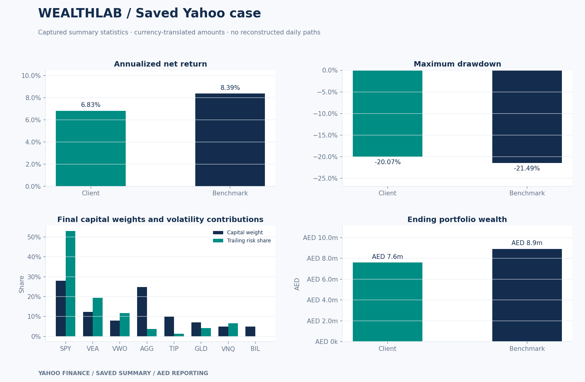
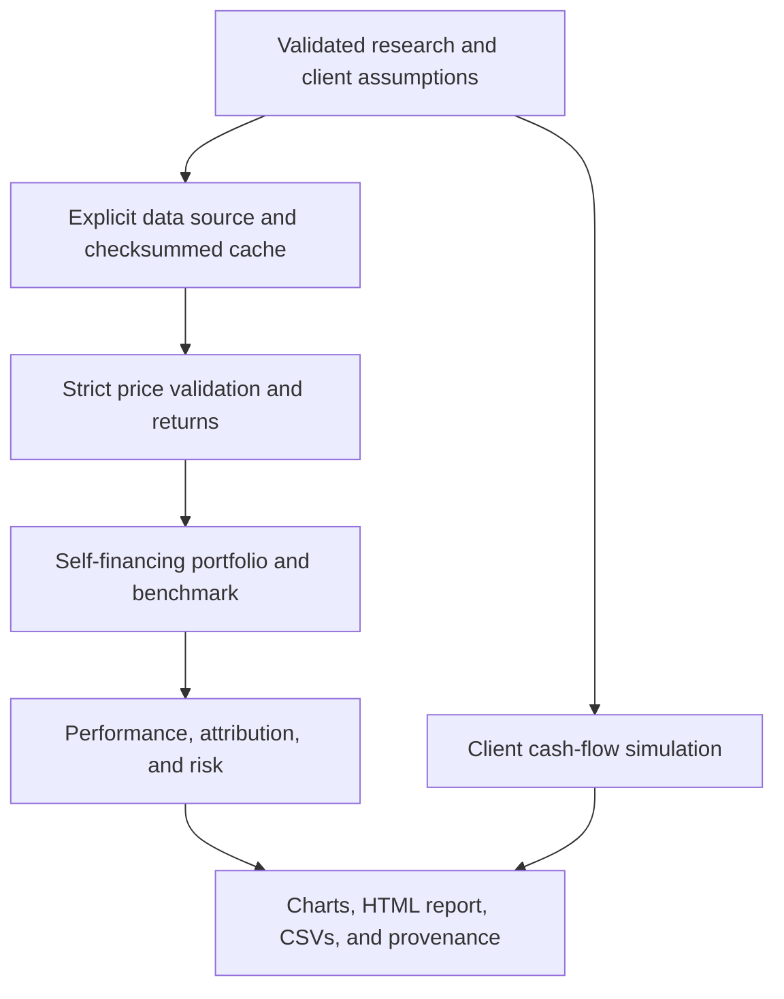

# WealthLab

**Multi-Asset Portfolio Analytics & Client Wealth Planning**

[Open in Google Colab](https://colab.research.google.com/github/KhalilChaaban/Wealthlab-portfolio-analytics/blob/main/WealthLab_Colab.ipynb) · [Findings](FINDINGS.md) · [Project reflection](docs/PERSONAL_REFLECTION.md) · [Research choices](docs/RESEARCH_NOTES.md)

Personal learning and research project developed with AI assistance.

This project compares an eight-ETF portfolio with a 60/40 benchmark and explores
how fees, risk, and client spending assumptions affect the results. It uses
Python and Google Colab, with a saved report that can be opened offline.

## Why I started this project

I started WealthLab to build my understanding of portfolio analysis, private
banking, and financial risk. I want to understand how portfolios respond to
changing market conditions and make more informed financial decisions. I'm also
interested in the assumptions behind the numbers and how bias can affect the
way results are interpreted.

I chose to use AI to support the coding and documentation so I could get early
experience of combining financial analysis with technology as a student. My
involvement included running the project in Colab, choosing Yahoo data, and
working through the outputs with guidance.

The challenges I worked through included learning the Colab workflow, working
with real market data, interpreting the return and risk trade-off, following
financial calculations, separating history from simulation, and keeping the
report consistent after the data source changed. The [project reflection](docs/PERSONAL_REFLECTION.md)
describes those experiences and what I still want to learn.

The [research notes](docs/RESEARCH_NOTES.md) explain the modeling choices and
which follow-up questions remain unanswered.



> **Finalized Yahoo Finance case:** real adjusted-price observations from
> 2015-01-02 to 2025-12-31. Historical portfolio returns are hypothetical backtest
> results. Client projections and stress scenarios remain modeled assumptions.

## Open the completed project

Double-click **`START_HERE.html`**, then choose **Open the Yahoo portfolio report**.
The updated notebook, findings, code, figures, and result tables are already in
place. Manual notebook replacement is unnecessary.

The example preserves the actual Yahoo outputs in the supplied Colab notebook.
Summary tables inherit saved display precision. The raw daily-price cache was
not attached; rerun the notebook for a fresh download and full daily CSV exports.
See [saved-case provenance](examples/yahoo/provenance.json).

## Findings from the Yahoo case

The portfolio used **2,766 common daily price observations**, a USD 1 million
starting account, monthly rebalancing, 5 bps of trading costs, and a 0.50%
annual advisory fee.

| Metric | Client portfolio | 60/40 strategic benchmark |
|---|---:|---:|
| Annualized return | 6.83% | 8.39% |
| Annualized volatility | 9.38% | 10.93% |
| Maximum drawdown | -20.07% | -21.49% |
| Sharpe ratio | 0.49 | 0.57 |
| Ending wealth from USD 1 million | USD 2,068,725 | USD 2,425,312 |

The portfolio was less volatile, but earned less than the benchmark. SPY
accounted for approximately 27.93% of ending capital and 53.02% of estimated
trailing volatility. It was also the largest positive dollar contributor.
Sharpe uses an assumed 2.50% annual risk-free rate in this case.

Client planning was separate: 89.32% of simulated paths funded all spending,
while 65.68% also met the terminal legacy target. These are assumption-dependent
simulation frequencies, not forecasts. Read [FINDINGS.md](FINDINGS.md) for the
full discussion and limitations.

## Start in Colab

1. Open [Google Colab](https://colab.research.google.com/).
2. Choose **File → Upload notebook** and select `WealthLab_Colab.ipynb`.
3. Choose **Runtime → Run all**. The notebook contains every Python module and
   recreates its own working project; uploading the ZIP is unnecessary.
4. Leave `SOURCE = "yahoo"` for real observations. Synthetic mode is available
   only as an explicit offline research/test option.
5. Download `client_report.html` and the generated run bundle in the export cell.

The notebook installs core dependencies only if missing. Yahoo mode also checks
for its optional adapter. FRED requires your own `FRED_API_KEY`, preferably entered
through Colab Secrets. Yahoo needs no API key. The explicit offline synthetic
test mode needs neither network access nor API keys.

## Start locally

```bash
python -m venv .venv
source .venv/bin/activate
python -m pip install -r requirements-live.txt
python -m unittest discover -s tests -v
python -m wealthlab --config config/yahoo.json --root .
```

Windows activation: `.venv\Scripts\activate`.

For live research:

```bash
python -m pip install -r requirements-live.txt
python -m wealthlab --source yahoo --start 2015-01-01 --end 2026-01-01 --root .
```

The end date is exclusive. Default historical dates are fixed for reproducibility,
not automatically extended to today. Use `--refresh` to intentionally replace an
existing matching cache snapshot. Keep an old snapshot separately if needed.

## What is built

- Eight USD-listed ETF proxies, a default 60/40 benchmark, and fixed strategic weights.
- Drifting holdings with monthly, quarterly, or buy-and-hold schedules.
- Self-financing transaction costs, calendar-day advisory fees, and exact dollar P&L attribution.
- CAGR, Sharpe, Sortino, drawdown, historical VaR/ES, beta, and tracking error.
- Trailing Euler risk contributions and hypothetical portfolio stresses.
- Monthly client cash-flow simulation with inflation, one-off spending, and a real legacy target.
- Five professional figure panels, eleven analytical CSV tables, strict JSON provenance,
  and a standalone HTML report with all images embedded.
- Offline tests, a GitHub Actions workflow, and an executable self-contained Colab notebook.
- Findings generated from each run and included in its notebook view and HTML report.

## Architecture



## Repository map

| Path | Purpose |
|---|---|
| `WealthLab_Colab.ipynb` | Complete standalone notebook, including all module source |
| `START_HERE.html` | Simple entry page for the completed case |
| `FINDINGS.md` | Discussion of the saved Yahoo results |
| `docs/PERSONAL_REFLECTION.md` | Motivation, approach, and challenges worked through with guidance |
| `docs/RESEARCH_NOTES.md` | Modeling choices, interpretation, and open questions |
| `wealthlab/config.py` | Validated research and client assumptions |
| `wealthlab/data.py` | Synthetic generator, Yahoo/FRED adapters, caching, quality checks |
| `wealthlab/portfolio.py` | Holdings, rebalancing, transaction costs, and fees |
| `wealthlab/analytics.py` | Performance, risk, attribution, monthly returns, stress |
| `wealthlab/planning.py` | Monthly wealth simulations and sensitivity |
| `wealthlab/charts.py` | Five matplotlib figure panels |
| `wealthlab/report.py` | Embedded HTML report and safe JSON serialization |
| `wealthlab/findings.py` | Source-aware findings generated from actual run metrics |
| `wealthlab/pipeline.py` | Reproducible workflow and exports |
| `wealthlab/__main__.py` | Command-line interface |
| `tests/` | Offline accounting, data-contract, and planning tests |
| `tools/` | Notebook generation and execution checks |
| `config/yahoo.json` | Editable Yahoo case mandate |
| `config/demo.json` | Explicit offline test mandate |
| `docs/PROJECT_GUIDE.md` | Full build guide, equations, use cases, resume wording, upgrades |
| `docs/VALIDATION.md` | Validation scope and limitations |
| `examples/yahoo/` | Saved Yahoo report, original figures, summary tables, and provenance |
| `data/cache/` | Local data snapshots; ignored by Git |
| `reports/{source}/{run_id}/` | Generated research outputs; ignored by Git |

## Default assumptions

| Assumption | Default |
|---|---|
| Research starting capital | USD 1,000,000 |
| Target weights | SPY 28%, VEA 12%, VWO 8%, AGG 25%, TIP 10%, GLD 7%, VNQ 5%, BIL 5% |
| Benchmark | SPY 60%, AGG 40%; same cost and fee conventions |
| Rebalance | First available close in a new calendar month |
| Trading cost | 5 bps of gross traded notional, including initial deployment |
| Advisory fee | 0.50% annual compounded reduction, accrued by elapsed calendar days |
| Risk-free assumption | 2.50% effective annual; optional lagged FRED DGS3MO proxy |
| Client planning wealth | USD 2,000,000; distinct from backtest capital |
| Annual spending | USD 72,000 in today's purchasing power |
| Additional goal | USD 250,000 in today's dollars at simulation month 24 |
| Planning horizon / legacy goal | 20 years / USD 500,000 in today's dollars |
| Planning return / volatility / inflation | 6% expected annual nominal simple return / 12% / 2.5% |
| Simulation | 5,000 paths; reproducible seed; no automatic historical calibration |

Change these assumptions in the notebook or `config/yahoo.json`. Local JSON use:

```bash
python -m wealthlab --config config/yahoo.json --root .
```

## Validation and limitations

Run `python -m unittest discover -s tests -v` and `python tools/check_notebook.py --source demo`.
The latter executes every plain-Python notebook code cell in a fresh temporary
directory. It is not a Jupyter-kernel or Colab-browser integration test.

The uploaded Colab notebook contains a successful Yahoo run and 38 passing
tests. The finalization environment cannot make a new Yahoo download. The saved
Yahoo outputs and plots were preserved, the findings were corrected, and the
updated reporting code was tested independently offline. FRED was not used in
the saved case. See [validation details](docs/VALIDATION.md).

No taxes, suitability determination, lending, estate planning, whole-share lots,
broker execution, point-in-time security selection, or exchange-calendar
completeness guarantee is included. See the guide for the financial consequences
of these assumptions. Do not publish Yahoo-derived data without verifying rights.

## Resume description

Use after reproducing the work and being able to explain its assumptions:

> Built a Python/Google Colab wealth analytics platform combining multi-asset
> portfolio accounting, transaction-cost-aware rebalancing, reconciled dollar
> attribution, risk diagnostics, and Monte Carlo client spending analysis;
> produced reproducible HTML reports with documented data provenance and automated
> financial validation tests.

Describe the historical case as a hypothetical portfolio backtest using real
Yahoo prices, and the forward planning as simulation. Do not claim live client
use, investment outperformance, regulatory compliance, or production deployment.

## Primary documentation

- [yfinance download parameters](https://ranaroussi.github.io/yfinance/reference/api/yfinance.download.html)
- [yfinance project and usage notice](https://github.com/ranaroussi/yfinance)
- [FRED observations API](https://fred.stlouisfed.org/docs/api/fred/series_observations.html)
- [FRED API keys](https://fred.stlouisfed.org/docs/api/api_key.html)
- [FRED/ALFRED real-time periods](https://fred.stlouisfed.org/docs/api/fred/realtime_period.html)
- [UBS investment philosophy](https://www.ubs.com/us/en/wealth-management/insights/article.3760299.html)
- [J.P. Morgan private-bank services](https://privatebank.jpmorgan.com/nam/en/services)

Code license: MIT; provider data remains subject to its own terms.
