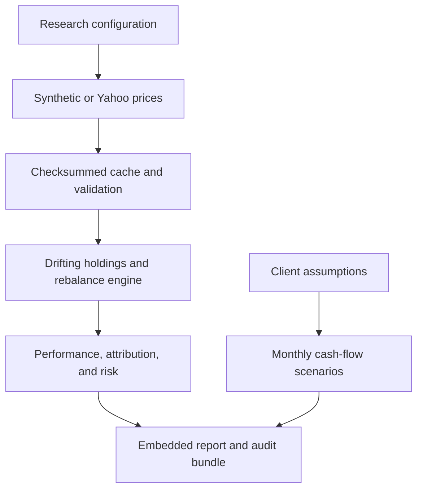

# WealthLab — Complete project and build guide

## 1. Project overview

**Project:** Multi-Asset Portfolio Analytics & Client Wealth Planning.

**Audience:** A finance student or junior analyst targeting private banking,
wealth management, investment advisory, or portfolio analytics.

**Question:** How did a diversified portfolio perform, which holdings drove
its outcome and risk, and how sensitive is a fictional family's spending plan
to investment assumptions?

**Difficulty:** Intermediate Python foundations through advanced portfolio accounting.
The engine is a well-documented research prototype. Production deployment would
require a larger data-control, security, operational, and governance framework.

The project has two deliberately separate analytical tracks:

1. Historical portfolio accounting, without client deposits or withdrawals.
2. Prospective, assumption-driven client spending scenarios.

Historical results do not automatically become forward return assumptions.
The finalized historical case uses real Yahoo Finance adjusted prices from the
supplied, successfully executed Colab notebook. Its portfolio returns are a
hypothetical backtest. Forward client planning and stresses remain simulations.
The saved summaries and original charts are preserved; the raw daily-price
cache was not attached. Re-run the notebook to create a fresh full-data export.

## 2. Real-world finance use case

A private-bank analyst prepares a portfolio review for a fictional family.
The family has USD 2 million of investable wealth, annual real spending of
USD 72,000, an additional USD 250,000 goal in month 24, and a desired real
legacy of USD 500,000 after 20 years. These are case assumptions, not facts
about the user.

The analyst needs to explain diversification, concentration, interest-sensitive
assets, losses under stress, fees, and the sensitivity of the plan. A relationship
manager could use similar analysis as an input to a discussion with investment,
lending, and planning specialists. This software does not replace those roles
or determine what is suitable for an actual person.

The quantitative contribution is transparent accounting and useful decision
support: different capital weights can create very different risk exposures;
small changes in spending or return assumptions can materially change outcomes.

## 3. System architecture

An optional FRED input supplies a lagged yield proxy for excess-return metrics.
It is not a portfolio holding and is not used to add a second return to BIL.

The Colab notebook embeds every source module in clearly numbered build cells.
Running these cells recreates the same package structure used locally and on
GitHub. Analysis calls then use normal imports rather than a monolithic script.

## 4. APIs and sources

| Input | Default | Optional live route | Important convention |
|---|---|---|---|
| Asset price history | Yahoo through yfinance | Explicit synthetic mode for offline tests | Adjusted close; end date exclusive |
| Corporate-action adjustment | Yahoo adjusted prices | Embedded in synthetic test indices | Do not add dividends to adjusted returns again |
| Risk-free comparison | Explicit 2.5% annual assumption | FRED DGS3MO with personal API key | One-day minimum lag, 7-day maximum stale age; yield approximation |
| Portfolio mandate | User configuration | Same | Fixed before the historical calculation |
| Client goals | Fictional configuration | Same | Dollars are USD; real-dollar goals share a t=0 basis |
| API credentials | None needed | Environment or Colab Secrets | Never stored in notebooks, manifests, or Git |

SEC EDGAR, FMP, Alpha Vantage, and paid tick feeds are unnecessary for this
ETF-level project. A licensed daily-price provider can replace Yahoo later by
returning the same wide adjusted-price DataFrame and provenance metadata.

Yahoo's Python wrapper is unofficial and its project warns about personal-use
data terms. FRED requires each user to use their own API key. These interfaces
are conveniences for research, not guaranteed institutional data services.

## 5. Libraries and runtime

| Library | Role | Needed for offline demo? |
|---|---|---|
| numpy | Arrays, scenario simulation, vectorized holdings math | Yes |
| pandas | Dated data, alignment, returns, tables | Yes |
| scipy | Available for quantitative extensions; current core equations use NumPy | Installed core research dependency |
| matplotlib | Professional saved figures | Yes |
| yfinance | Yahoo adapter | No |
| requests | Optional FRED adapter, HTTP retries and timeouts | No |
| ipywidgets | Optional Colab sensitivity controls | No |
| unittest | Financial validation tests | Python standard library |
| json, hashlib, pathlib, logging | Configuration, provenance, filesystem and diagnostics | Python standard library |

Python 3.10+ is supported by the code's syntax. The artifact's actual exercised
environment is recorded in `requirements-tested.txt` and the example manifest.
The core demo does not need a GPU. Optional widgets are detected; their absence
does not prevent notebook completion.

## 6. Folder and file structure

| File or directory | Responsibility |
|---|---|
| `WealthLab_Colab.ipynb` | Single upload, all source code, analysis, figures, export |
| `wealthlab/config.py` | ResearchConfig and ClientConfig input contracts |
| `wealthlab/data.py` | Source adapters, atomic caching, adjusted-close extraction, quality checks |
| `wealthlab/portfolio.py` | Daily holdings state and exact self-financing cost solution |
| `wealthlab/analytics.py` | Metrics, dollar attribution, risk contribution and stresses |
| `wealthlab/planning.py` | Cash-flow simulation and sensitivity grid |
| `wealthlab/charts.py` | Five multi-panel PNG figures |
| `wealthlab/report.py` | Offline HTML dashboard and strict JSON |
| `wealthlab/pipeline.py` | End-to-end orchestration and output tables |
| `wealthlab/__main__.py` | Local command-line interface |
| `config/demo.json` | Editable default assumptions |
| `tests/test_accounting.py` | Independently calculated holdings and cost cases |
| `tests/test_data.py` | Provider contracts, quality failures, cache and lag behavior |
| `tests/test_planning.py` | Cash-flow boundaries, depletion, inflation and determinism |
| `tools/build_notebook.py` | Rebuild notebook from maintained source files |
| `tools/check_notebook.py` | Execute every code cell; --source demo explicitly selects offline verification |
| `docs/` | Methodology, validation, sources and preview image |
| `examples/yahoo/` | Preserved Yahoo charts, summary tables, report, and provenance |
| `FINDINGS.md` | Corrected discussion of the saved Yahoo results |
| `START_HERE.html` | Entry page for the complete organized project |
| `data/cache/` | Private local price/rate snapshots, excluded from Git |
| `reports/` | New analytical runs, separated by source and input/code hash |

## 7. Step-by-step build guide

### Step 1 — Set up the environment

Upload the notebook to Colab. The first code cell detects missing core libraries
and installs them only when needed. Local users install `requirements.txt`.
No network installation is required in an environment already containing the core.

### Step 2 — Materialize the package

The next numbered cells write each embedded module into `wealthlab/` inside a
dedicated notebook workspace. This makes the package inspectable and reusable.
Do not edit only the emitted files and then rerun their bootstrap cells: those
cells intentionally restore the embedded version. For maintained development,
edit the repository modules and regenerate the notebook.

### Step 3 — Define the mandate

Set target and benchmark weights, dates, cost assumptions, rebalance frequency,
and source. The defaults are long-only and fully invested. Weights must sum to
one; the engine does not silently normalize them. Use the eight supported ETF
labels unless you also extend the demo generator and stress mappings.

### Step 4 — Collect and validate data

Load the selected source into a wide price table, then run quality checks.
Review the data-quality output before trusting results. Yahoo mode does not
switch to synthetic data if the provider fails.

### Step 5 — Build the accounting track

Run the client portfolio, strategic benchmark, and a frictionless comparison.
The latter removes the explicitly modeled advisory fee and transaction cost;
fund operating expenses already embedded in market total returns remain embedded.

### Step 6 — Inspect financial identities

The accounting engine requires asset dollar P&L minus all modeled costs to equal
the change from starting capital to ending NAV. Review weight sums, fee totals,
and sample rebalance dates. Test a small known case before scaling up.

### Step 7 — Produce performance and risk diagnostics

Calculate the metric table, exact dollar attribution, rolling volatility,
monthly returns, trailing risk decomposition, and hypothetical stresses.
Compare risk contribution with capital allocation; they answer different questions.

### Step 8 — Add the client planning track

Specify current wealth, spending, the one-off goal, inflation, return, volatility,
and a legacy target. Run monthly simulations and the return/spending sensitivity
grid. Use scenario distributions instead of reporting a single terminal value.

### Step 9 — Build the report

`run_project()` executes the same analysis and saves all figures, tables,
assumptions, data quality, checksums, package versions, and HTML. Embedded images
make the report portable without a chart CDN or internet connection.

### Step 10 — Validate and prepare GitHub

Run offline unit tests and the notebook checker. Review saved charts. Publish
the source, documentation, notebook, and correctly labeled Yahoo case bundle. Do not commit
API keys or assume downloaded vendor data can be redistributed. The included
GitHub Actions workflow is supplied for future repository execution; no external
repository has been created or published by this deliverable.

## 8. Collection pipeline

The price-cache key combines source, date range, ordered universe, adjustment
policy, and demo-generator seed/version. A SHA-256 digest protects the actual CSV
bytes. Data is read back from the exact saved bytes on the first run so cached
and uncached analyses receive identical numerical inputs.

Yahoo downloads use explicit parameters: daily interval, `auto_adjust=False`,
`back_adjust=False`, `repair=False`, and `actions=True`. The adapter extracts
`Adj Close` from either common MultiIndex orientation. Missing fields are errors.
Three bounded attempts handle transient failures, with short exponential waits.

FRED uses an HTTPS request with connect/read timeouts and bounded retries. The
credential is never part of the cache key or emitted errors. Cached payloads
also carry checksums and retrieval dates. Latest-retrieved observations are
lagged at least one calendar day before risk-free accrual. This does not recreate
historical publication vintages perfectly; it is a documented comparison proxy.

## 9. Cleaning and feature engineering

1. Verify all required assets and unique asset columns.
2. Parse date-only timestamps, sort chronologically, and preserve calendar labels.
3. Remove identical duplicate rows; reject conflicting duplicate-date prices.
4. Reject infinity, zero, negative prices, and nonnumeric values.
5. Establish a common valid boundary across assets and the requested date range.
6. Reject interior missing values. No forward-fill or backfill is performed.
7. Reject insufficient history, materially late inception, stale ending history,
   and unusually long calendar gaps.
8. Flag daily absolute moves above 20% for review; do not clip them.
9. Compute simple returns explicitly with `pct_change(fill_method=None)`.

These checks do not prove every exchange session is present. A fully absent
market date may evade a heuristic gap check. An exchange-calendar and independent
source-reconciliation layer is an explicit upgrade.

Derived features include rolling 63-session volatility, monthly compounded
returns, drawdowns, trailing 252-session covariance, capital/risk weights,
asset-level dollar profits, and gross traded NAV fractions. No machine-learning
feature selection or return optimization is hidden in this project.

## 10. Core models and algorithms

### Holdings and rebalancing

Let asset holdings be dollar values H, target weights w, and proportional
transaction cost c. After asset returns, holdings drift naturally. Advisory fees
reduce all positions proportionally. On a scheduled rebalance, solve:

$$V_{after}+c\sum_i|w_iV_{after}-H_i|=V_{before}.$$

Bisection produces a self-financing result. Initial deployment uses H = 0 and
starting cash equal to the configured capital. If all cash is invested, initial
post-cost NAV is capital divided by (1+c).

Rebalances occur at the first observed close of a new month or quarter. This
fixed schedule needs no knowledge of the next observation. The policy assumes
fractional holdings and closing-price execution plus proportional costs; it does
not model an actual broker fill or holdings in raw share units.

Annual advisory fee f over d calendar days reduces wealth by a factor:

$$(1-f)^{d/365.25}.$$

This specifies an effective annual fee reduction rather than a daily simple-rate
approximation. Fees accrue across weekends. Embedded fund fees are not deducted
again.

### Return and dollar attribution

Later daily returns are NAV_t / NAV_(t-1) - 1. The first row records initial
deployment cost against starting capital. The product over every row equals
ending NAV divided by initial capital.

Dollar attribution is exactly additive:

$$V_T-V_0=\sum_{t,i}H_{i,t-1}r_{i,t}-\sum_t TradingCost_t-\sum_t AdvisoryFee_t.$$

This is holding-level dollar contribution, not Brinson sector attribution or
causal attribution. It avoids summing unlinked daily percentage contributions
and labeling them cumulative return attribution.

### Risk decomposition

Using trailing annualized covariance Sigma and latest held weights w:

$$\sigma_p=\sqrt{w^T\Sigma w},\qquad RC_i=\frac{w_i(\Sigma w)_i}{\sigma_p}.$$

Components sum to portfolio volatility; dividing by volatility gives risk shares
that sum to one. Negative components remain visible. Sample covariance is
appropriate for a transparent baseline, not a claim of superior forecasting.

### Planning simulation

For annual expected simple nominal return mu and annual log-return volatility
sigma, monthly gross growth is:

$$G_m=\exp\left(\frac{\log(1+\mu)-\sigma^2/2}{12}+\frac{\sigma Z_m}{\sqrt{12}}\right).$$

This yields expected annual gross growth 1+mu before fees. Beginning-of-month
spending and one-off costs increase with deterministic inflation. Remaining
wealth earns the monthly growth factor and pays an advisory fee. Depletion is
absorbing. Real wealth divides nominal wealth by the cumulative inflation factor.

Report both the frequency of funding all scheduled spending and the frequency
of funding spending AND achieving the terminal real legacy target. Monte Carlo
standard error describes simulation sampling noise only; model uncertainty is
larger and is not captured by that standard error.

The sensitivity grid uses common random numbers so differences across assumptions
have less simulation noise. It is not an optimizer or a recommended allocation.

## 11. Visualizations and dashboard

| Panel | Contents | Interpretation |
|---|---|---|
| Portfolio overview | Growth, drawdown, capital weights, risk shares | What happened and where risk sits |
| Risk diagnostics | Rolling volatility, correlation, monthly heatmap, daily-return histogram | Stability, co-movement and historical tails |
| Attribution | Dollar P&L by asset/cost and weight history | Reconciled performance and allocation drift |
| Client projection | Real-wealth fan chart and terminal distribution | Outcomes under explicitly chosen assumptions |
| Sensitivity and stress | Spending/return grid and three portfolio shocks | Dependence on assumptions and current exposure |

The HTML report includes navigation, metric cards, the fictional case, a full
metric table, expandable assumptions/provenance, and print styling. It embeds
all PNGs and opens offline. It is an explanatory report, not a live trading app.
The notebook adds optional sliders for planning assumptions when ipywidgets is
available. Those exploratory sliders do not silently overwrite the saved report.

## 12. Performance metrics

| Metric | Definition / convention |
|---|---|
| Total return | Ending NAV / starting capital - 1; includes initial purchase costs |
| CAGR | Geometric growth using actual elapsed days / 365.25 |
| Annualized volatility | Daily return sample standard deviation × sqrt(252) |
| Sharpe | Mean daily excess return / its sample standard deviation × sqrt(252) |
| Sortino | Annualized excess-return mean relative to full-sample downside deviation |
| Maximum drawdown | Lowest NAV / running peak - 1; initial capital is a peak candidate |
| Calmar | CAGR / absolute maximum drawdown |
| Historical daily VaR 95% | 95th empirical quantile of negative daily returns |
| Historical daily ES 95% | Mean loss at or beyond that threshold; ties included |
| Tracking error | Daily active-return sample standard deviation × sqrt(252) |
| Information ratio | Annualized arithmetic active mean / tracking error |
| Beta | Return covariance with strategic benchmark / benchmark variance |
| Annual gross turnover | Sum of buys-plus-sells / pre-trade NAV, divided by elapsed years; initial deployment excluded |
| Transaction costs / advisory fees | Actual deducted dollars, not terminal wealth difference |

The initial cost-only row has no elapsed return interval. It enters total return,
CAGR, drawdown, monthly returns, and dollar attribution, but is excluded from
daily-distribution risk statistics. A zero denominator produces an undefined
ratio, serialized as JSON null and displayed as 'Undefined'.

VaR/ES are descriptive historical estimates, not forecasts or regulatory models.
No independence or normality claim justifies the square-root annualization; it
is a reporting convention whose limits matter when returns are autocorrelated.

## 13. Final deliverables and resume positioning

The deliverables are the complete self-contained notebook, reusable Python
package, tests, command-line entry point, dependency specifications, guide,
Yahoo case dashboard, analytical summary tables, original figures, assumptions, and
checksummed run manifest. The notebook exports a ZIP of the specific run.

Suggested resume wording after reproducing and understanding the project:

> Developed a Python/Google Colab wealth analytics platform with self-financing
> multi-asset portfolio accounting, transaction-cost-aware rebalancing, reconciled
> dollar attribution, risk decomposition, and Monte Carlo client spending analysis;
> automated reproducible HTML reporting and financial validation checks.

Interview topics to prepare:

- Why adjusted-price returns must not have dividends added twice.
- Why a 30% capital weight may contribute substantially more than 30% of risk.
- How costs are funded when the portfolio is fully invested.
- Why historical CAGR is not a defensible default forward-return assumption.
- How sequence of returns interacts with withdrawals.
- Why a model's success frequency is conditional on assumptions.
- Which requirements separate this prototype from a live advisory system.

## 14. Potential upgrades

| Upgrade | Finance purpose | Engineering requirement |
|---|---|---|
| Black–Litterman allocation | Incorporate investment views and uncertainty | Separate view inputs, posterior checks, constrained optimizer |
| Tax-aware rebalancing | Study after-tax implementation | Jurisdiction-specific rules, lots, holding periods, independent validation |
| External cash flows and XIRR | Analyze actual client funding | Flow ledger, valuation timing, time-weighted and money-weighted returns |
| Income ledger | Separate cash distributions from capital gains | Raw prices, distributions, tax handling and reinvestment choices |
| Securities-backed lending | Explore liquidity and collateral stress | Haircuts, interest, maintenance thresholds, forced-sale scenarios |
| Exchange calendar and second provider | Strengthen data controls | Session completeness, independent reconciliation, corporate actions |
| Block bootstrap / regime scenarios | Challenge lognormal planning | Dependence-preserving samples, model comparison, tail stress |
| Multi-currency wealth | Include base-currency and FX risks | Timestamp alignment, FX conversion, account currency rules |
| Bond-level holdings | Improve duration and cash-flow detail | Pricing, coupons, accrued interest and conventions |
| Production service | Support controlled operational use | Authentication, privacy, persistent database, monitoring, access controls, review |

Prioritize external cash-flow accounting and data controls before adding more
complex prediction models. The most useful extension for investment-strategy
roles is Black–Litterman; for private-bank relationship support, goals, liquidity,
and communication deserve priority.

## Sources and scope

Primary provider references checked for this project:

- https://ranaroussi.github.io/yfinance/reference/api/yfinance.download.html
- https://github.com/ranaroussi/yfinance
- https://fred.stlouisfed.org/docs/api/fred/series_observations.html
- https://fred.stlouisfed.org/docs/api/api_key.html
- https://fred.stlouisfed.org/docs/api/fred/realtime_period.html

Industry context:

- https://www.ubs.com/us/en/wealth-management/insights/article.3760299.html
- https://privatebank.jpmorgan.com/nam/en/services

The project design and calculations are independent educational implementations;
these institutions have not endorsed or validated the software.
